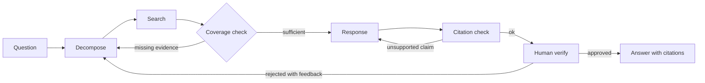

# Codebase Explainer

A multi-agent RAG assistant that answers architecture questions about a codebase. It searches code and documentation together, checks whether the evidence is enough, searches again if it is not, and answers with citations. If the repository does not cover the question, it says so.

**Status:** work in progress. The retrieval, agent graph, API and evaluation harness are written. The setup below has not been verified end to end, and the evaluation results are not yet where they need to be (see [Evaluation](#evaluation)).

## Problem

Questions such as "how does authentication work in this service?" are rarely answered by a single file. The answer is spread across a README, a config module, middleware and a utility several folders away. A plain RAG chatbot retrieves once and answers from an incomplete picture, and the answer still sounds confident.

This project treats retrieval as part of the reasoning loop. The system decides mid-answer whether it needs another search hop, and it is evaluated on whether it correctly refuses to answer when the evidence is missing.

## How it works



- **Decompose:** splits the question into search queries and tracks a checklist of what must be found.
- **Search:** hybrid retrieval over Qdrant. Dense vectors use `voyage-code-3`, sparse vectors use BM25 (fastembed), and results are reranked with Voyage `rerank-2`. Code and documentation live in separate collections.
- **Coverage check:** decides whether the gathered chunks are sufficient. It stops after 3 hops, or earlier if a hop adds no new chunks, and the response step then abstains.
- **Response and citation check:** writes the answer, then verifies that each claim is supported by a cited chunk.
- **Human verify:** an interrupt step where a reviewer approves or rejects the answer. Rejection with feedback sends the question back to decompose, up to 2 times.

The agent graph is built with LangGraph. Tracing is optional through Arize Phoenix.

The target repository indexed for the evaluation is [Backstage](https://github.com/backstage/backstage).

## Tech stack

Python 3.11+, LangGraph, LangChain, OpenAI (`gpt-4o-mini`), Qdrant, Voyage AI, fastembed, LlamaIndex (code splitting), FastAPI, RAGAS, Arize Phoenix, Docker.

## Project structure

```
agents/      decompose, searcher, coverage_check, response, citation_check, human_verify
graph/       LangGraph definition and routing rules
retrieve/    dense, sparse and reranked search against Qdrant
ingest/      chunking and indexing of code (tree-sitter) and docs
api/         FastAPI app (POST /trigger)
evals/       golden question set, baseline and pipeline evaluation
docs/        original project plan and agent-layer checklist
```

## Setup

You need Python 3.11+, a Qdrant instance, and OpenAI and Voyage API keys.

```bash
git clone https://github.com/Anubhav6205/codebase-explainer-rag.git
cd codebase-explainer-rag
pip install .
cp .env.example .env      # then fill in your keys
```

Index a repository: place a checkout of the target repo at `ingest/backstage` and run the four scripts in `ingest/ingestion/` (`dense/` and `sparse/`, each with `logic.py` and `docs.py`).

Run the API:

```bash
uvicorn api.main:app --port 8000
curl -X POST localhost:8000/trigger -H "Content-Type: application/json" \
  -d '{"query": "How are entity YAML files validated?", "thread_id": "demo"}'
```

A `Dockerfile` and `docker-compose.yml` (API plus a local Qdrant) are included. They have not been tested since the last refactor.

## Evaluation

`evals/golden.json` holds 31 questions about Backstage. Each answerable question lists the complete set of source files needed, and 10 questions are deliberately unanswerable to test abstention. `evals/pipeline_eval.py` runs the graph over the set and reports RAGAS faithfulness, context precision and context recall, plus a false-confidence rate (the system declared its evidence sufficient on an unanswerable question).

One run from 18 September 2026 gave:

| Metric | Result |
|---|---|
| Context recall | 0.95 |
| Faithfulness | 0.79 |
| Context precision | 0.69 |
| False-confidence rate | 1.0 (10 of 10 unanswerable questions) |

Retrieval works well. Abstention does not yet: the system answers every unanswerable question, which is the main thing left to fix. The CI workflow in `.github/workflows/eval.yml` gates on these metrics. It is manual-trigger only because it calls paid APIs.

## Known issues and roadmap

- Fix abstention so that unanswerable questions are refused.
- `docs/agent_layer_checklist.md` lists remaining bugs in the agent layer.
- Verify the Docker setup and add a short unit test suite that does not need API keys.
- Add a demo recording.

## License

MIT, see [LICENSE](LICENSE).

## Contact

Anubhav Gupta, [LinkedIn](https://www.linkedin.com/in/anubhav-gupta-92410a244/)
